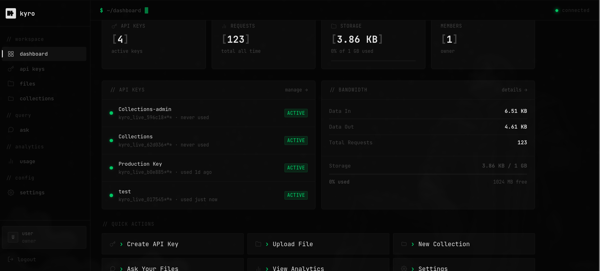
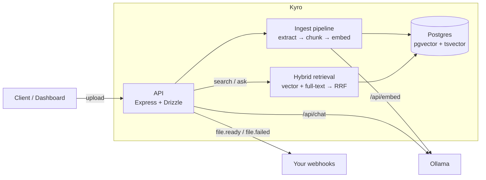

<p align="center">
  
</p>

<h1 align="center">Kyro</h1>

<p align="center">
  <strong>A self-hosted document API with retrieval-grounded answers, powered by local models.</strong><br/>
  Upload PDFs, DOCX and text files, then search and ask questions across them.<br/>
  Your documents and your models stay on your own infrastructure.
</p>

<p align="center">
  <a href="https://kyro.nyxox.dev/docs">API Docs</a> ·
  <a href="ARCHITECTURE.md">Architecture</a> ·
  <a href="https://github.com/Kyroinfra/kyro-sdk-typescript">TypeScript SDK</a> ·
  <a href="packages/api/openapi.yaml">OpenAPI Spec</a>
</p>



<!-- TODO: replace with a 20-30s demo GIF: upload a PDF → ask a question → streamed answer with sources -->

## Why Kyro

Many teams can't send contracts, reports or internal documents to a third-party AI provider. Kyro gives them a complete backend for document Q&A that runs on their own hardware:

- **Local models only.** Embeddings and answers come from [Ollama](https://ollama.com). No data leaves your network.
- **Hybrid retrieval.** Vector search and full-text search are fused with Reciprocal Rank Fusion, so both meaning-based and exact-term queries work.
- **Multi-tenant by design.** Organisations, roles, scoped API keys, and org isolation enforced in every query.
- **Operable.** One status per file, signed webhooks, usage logs, health checks, and migrations that are safe to run concurrently.
- **One command to run.** Docker Compose brings up the API, dashboard, Postgres and Nginx.

## Features

| Area | What you get |
|---|---|
| Ingestion | PDF, DOCX and TXT are extracted, chunked and embedded. CSV and JSON are stored without extraction. |
| Search | `GET /search` returns ranked chunks with RRF scores, optionally scoped by collection, file IDs or metadata filters. |
| Ask | `POST /ask` streams answers over SSE with numbered source citations, or returns one JSON body. Multi-turn history is supported. |
| Collections | Group files and scope search and Q&A to a collection. |
| Metadata filters | Attach key/value metadata to files and filter retrieval on it (AND across keys, OR within a key). |
| Auth | JWT sessions and hashed API keys (`read` / `write` scopes). Roles: owner, admin, member. |
| Webhooks | `file.ready` and `file.failed` events, HMAC-SHA256 signed, with retries and exponential backoff. |
| Dashboard | SvelteKit app for files, collections, search, chat, API keys, usage and team management. |
| SDK | [TypeScript SDK](https://github.com/Kyroinfra/kyro-sdk-typescript). |

## Quick start

**Prerequisites:** [Docker](https://docs.docker.com/get-docker/) with Compose, and [Ollama](https://ollama.com) running on this machine or another one.

```bash
# 1. Clone and configure
git clone https://github.com/Kyroinfra/Kyro
cd Kyro
cp .env.example .env        # then set POSTGRES_PASSWORD and JWT_SECRET

# 2. Pull the models
ollama pull nomic-embed-text
ollama pull llama3.2

# 3. Start the stack
./scripts/prod.sh
```

Open `http://localhost`, register (the first account becomes the organisation owner), upload a document, and ask it a question.

<details>
<summary><strong>Minimal <code>.env</code></strong></summary>

```env
POSTGRES_USER=kyro
POSTGRES_PASSWORD=changeme
POSTGRES_DB=kyro
JWT_SECRET=changeme          # use a long random string

# Ollama on the Docker host; use a URL for a remote GPU machine instead
OLLAMA_URL=http://host.docker.internal:11434

EMBEDDING_MODEL=nomic-embed-text
CHAT_MODEL=llama3.2
```

</details>

<details>
<summary><strong>Running manually or in development</strong></summary>

```bash
# Production, manually (3 API replicas)
docker compose -f compose.yml --profile prod up -d --scale api=3

# Development (hot reload, published ports, containerized Ollama, pgAdmin)
docker compose up
```

The explicit `-f compose.yml` matters in production: it skips `compose.override.yml`, the dev-only file Docker loads automatically.

</details>

## How it works



**Ingest.** Each upload moves through one status: `pending → processing → ready`, or `failed` / `skipped`. Text is extracted, split on paragraph boundaries into ~1,200-character chunks with 200 characters of overlap, embedded in batches of 32, and stored with a pgvector HNSW index plus a generated `tsvector` column for full-text search.

**Retrieve.** Each query runs two arms in parallel: cosine-distance vector search (with a configurable distance threshold) and full-text search. The two ranked lists are merged with Reciprocal Rank Fusion (k = 60), with deterministic tie-breaking. Only files with status `ready` can appear in results. An optional LLM-based reranking pass can be enabled with `RERANK_ENABLED`.

**Answer.** The top chunks are numbered and placed in a prompt that tells the model to answer only from the context and cite sources as `[1]`, `[2]`. Prior turns can be replayed for follow-up questions.

**Scope.** `/search` and `/ask` share one scope resolver. Collection membership, explicit file IDs and metadata filters are intersected, and both endpoints return the same status codes for the same failures (404 for unknown collection, 422 for empty scope).

See [ARCHITECTURE.md](ARCHITECTURE.md) for the full design: boot sequence, pipeline, retrieval SQL, webhooks, data model and configuration.

## Using the API

All examples use `http://localhost/api/v1`. Every org-scoped route accepts either `X-API-Key: <key>` or `Authorization: Bearer <jwt>`. Rate limit: 100 requests per key per minute.

**1. Create the first account.** The first registration creates the organisation and its owner. After that, signup is locked unless `ALLOW_SIGNUP=true`.

```bash
curl -X POST http://localhost/api/v1/auth/register \
  -H 'Content-Type: application/json' \
  -d '{"orgName":"Acme","email":"admin@acme.dev","password":"supersecret"}'
```

**2. Create an API key.** Owner or admin only. The plaintext key is shown once.

```bash
curl -X POST http://localhost/api/v1/keys \
  -H "Authorization: Bearer $TOKEN" \
  -H 'Content-Type: application/json' \
  -d '{"name":"ingest","scopes":["read","write"]}'
```

**3. Upload a file.**

```bash
curl -X POST http://localhost/api/v1/files \
  -H "X-API-Key: $KYRO_KEY" \
  -F file=@report.pdf
```

**4. Search.**

```bash
curl "http://localhost/api/v1/search?q=payment+terms&limit=5" \
  -H "X-API-Key: $KYRO_KEY"
```

**5. Ask.** Streams `sources`, then `chunk` events, then `done`. Pass `"stream": false` for a single JSON response.

```bash
curl -N -X POST http://localhost/api/v1/ask \
  -H "X-API-Key: $KYRO_KEY" \
  -H 'Content-Type: application/json' \
  -d '{"question":"What are the payment terms?","collectionId":"<uuid>"}'
```

The complete contract is in [`packages/api/openapi.yaml`](packages/api/openapi.yaml).

## Configuration

All configuration is read and validated in one place (`packages/api/src/config`). Invalid or missing required values stop the process at startup with a readable error.

| Variable | Default | Description |
|---|---|---|
| `DATABASE_URL` | required | Postgres connection string (set by Compose) |
| `JWT_SECRET` | required | Secret for signing session tokens |
| `OLLAMA_URL` | empty | Ollama base URL. If empty, embedding is skipped, search is full-text only, and `/ask` is disabled |
| `EMBEDDING_MODEL` | `nomic-embed-text` | Model used for embeddings |
| `EMBEDDING_DIM` | `768` | Must match the model and the pgvector column |
| `CHAT_MODEL` | `llama3.2` | Model used to answer questions |
| `RERANK_ENABLED` | `false` | Enable LLM-based reranking (adds one model call per candidate) |
| `RERANK_MODEL` | `llama3.2` | Model used for reranking |
| `VECTOR_DISTANCE_THRESHOLD` | `0.5` | Maximum cosine distance for the vector arm |
| `ALLOW_SIGNUP` | `false` | Allow registration after the first organisation exists |
| `STORAGE_LIMIT` | 10 GiB | Deployment-wide cap on stored bytes |
| `UPLOAD_DIR` | `./uploads` | Where uploaded files are stored |

> **Changing the embedding model:** if the new model has a different dimension, update `EMBEDDING_DIM`, generate a migration for the column, and re-embed existing files with `POST /files/:id/reprocess`.

## Evaluation

<!-- TODO: fill this in from the eval harness. This section is the most valuable part of the README once it has real numbers. -->

Retrieval quality is measured on a labelled question set over a public document corpus. Questions are labelled with evidence spans rather than chunk IDs, so the same labels work across chunking and embedding experiments.

| Configuration | Recall@5 | MRR | p95 latency |
|---|---|---|---|
| Vector only | _TBD_ | _TBD_ | _TBD_ |
| Full-text only | _TBD_ | _TBD_ | _TBD_ |
| Hybrid (RRF), current default | _TBD_ | _TBD_ | _TBD_ |
| Hybrid + rerank | _TBD_ | _TBD_ | _TBD_ |

Run it yourself: `eval/` _(instructions to come)_.

## Project layout

```
packages/
  api/    Express + Drizzle API: routes, RAG pipeline, webhooks, migrations
  web/    SvelteKit dashboard and same-origin API proxy
nginx/    Reverse proxy config (prod profile)
scripts/  Production and admin scripts
```

## Design decisions

- **No Redis, no job queue service.** The ingest pipeline and webhook delivery run in-process with bounded concurrency, and every state is recorded in Postgres. Fewer moving parts to self-host.
- **One pipeline, one status.** A file's whole ingest position lives in `files.status`, with failures in `files.error`. There is no second table to reconcile.
- **Same-origin dashboard.** The browser only talks to its own origin. A proxy injects the session token server-side, so no API key reaches client code.
- **Safe migrations.** Migrations run at API startup under a Postgres advisory lock, so concurrent starts queue instead of racing.
- **Org isolation in the query layer.** Every retrieval query filters on `org_id`, and client-supplied file IDs can only narrow, never widen, what a caller can see.

## Known limitations

Being upfront about these:

- Scanned PDFs are not supported (no OCR), so image-only files end up `skipped`.
- Citations reference file and chunk index, not page numbers.
- Full-text search is configured for English.
- Failed ingests are not retried automatically; re-run them with `POST /files/:id/reprocess`.
- Ingest state is held in-process. Files interrupted by a restart are marked `failed` at startup, so scaling API replicas while uploads are in flight can mark another replica's active files as failed. A Postgres-backed job queue is on the roadmap.
- Rate limits are per process, not shared across replicas.

## Roadmap

- [ ] Evaluation harness with published results
- [ ] Postgres-backed job queue for multi-replica ingestion
- [ ] Provider abstraction (Ollama, llama.cpp, vLLM / OpenAI-compatible)
- [ ] Per-stage latency metrics (embed, retrieve, rerank, generate)
- [ ] Page-level extraction and page citations
- [ ] MCP server exposing `/search`

## Contributing

Issues and pull requests are welcome. See [CONTRIBUTING.md](CONTRIBUTING.md) _(to add)_.

## License

_TBD: add a LICENSE file (MIT or Apache-2.0 are common choices)._
